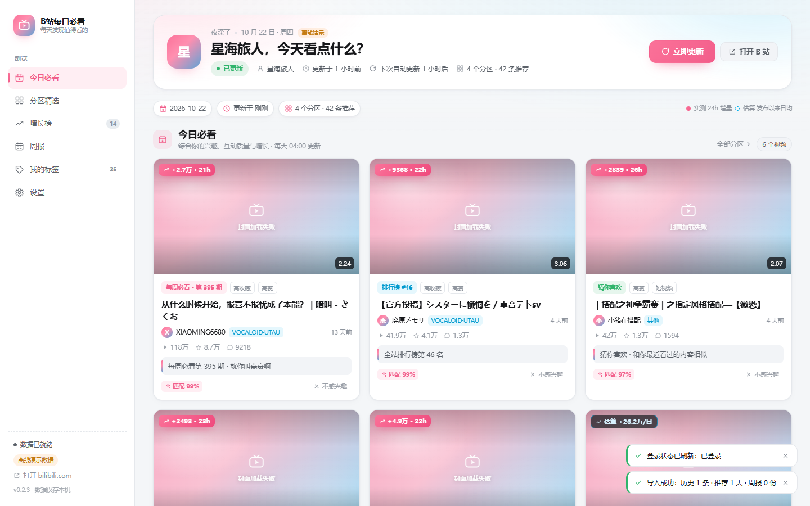
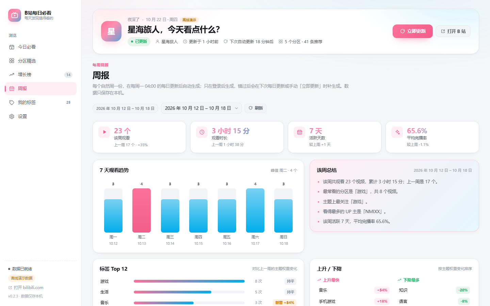
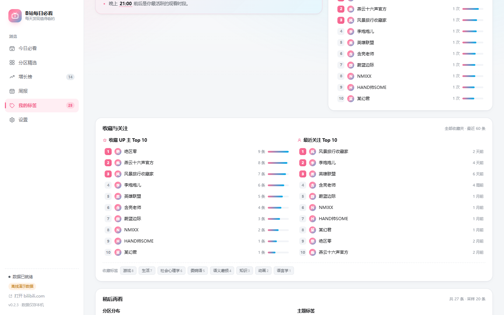
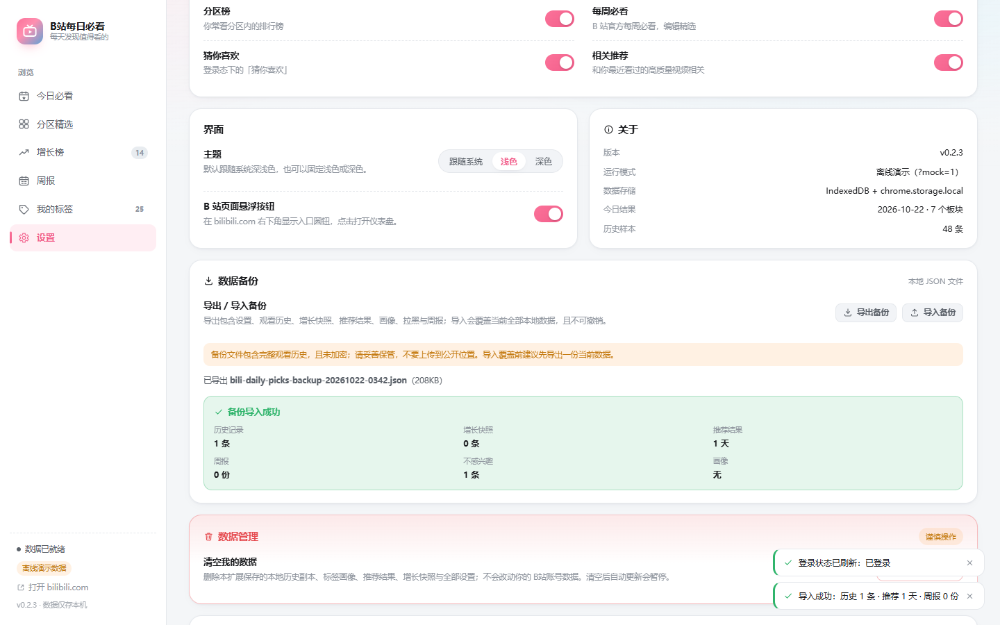

# B站每日必看

[](https://github.com/EricAndHisWordcards/bili-daily-picks/releases)


一个 Chrome / Edge 浏览器扩展：读取你自己的 B站历史记录，结合热门、排行榜、每周必看、
个性化推荐与本地记录的增长数据，每天生成「每日必看」清单，并统计你的观看标签与每周变化。

> 非官方项目，与哔哩哔哩无关联；所有数据只保存在本地。

- 每个一级分区推荐 **2–5 个**视频（默认 3 个，可在设置里调整）
- 推荐依据：分区/标签/UP 主偏好 × 互动质量（收藏、投币、点赞、评论/播放）× 播放与收藏增长 ×
  榜单名次 × 新鲜度；登录后还会使用**收藏夹（全部收藏夹最近 60 条）、关注列表、稍后再看**等只读信号
- 不只看爆款：会排除你已经看过的视频，同一天结果稳定，「换一批」不会重复
- 「我的标签」页展示主题标签云、分区偏好、常看 UP 主、观看时段、完播率、收藏/关注/稍后再看与画像总结
- 「周报」页每周一自动生成上一自然周的观看趋势、喜好标签与权重变化
- 账号卡片显示当前登录状态，可一键打开 B站登录页并刷新；数据备份支持 JSON 导出/导入

## 下载即用（普通用户）

不用安装 Node.js：到 [Releases](https://github.com/EricAndHisWordcards/bili-daily-picks/releases) 下载最新的
`bili-daily-picks-v0.2.3.zip`，解压后按下面的步骤加载解压出的文件夹。

1. 打开 `chrome://extensions`（Edge 为 `edge://extensions`）
2. 打开右上角「开发者模式」
3. 点「加载已解压的扩展程序」，选择解压后的文件夹（里面应有 `manifest.json`）
4. 首次安装会自动打开仪表盘；也可以在 B站页面右下角点悬浮按钮，或点击扩展图标打开

> Release 包只包含构建产物（`dist/`），不含源码；源码请直接克隆仓库。

## 从源码构建（开发者）

环境要求：Chrome / Edge 120 及以上；Node.js 20 及以上。

仓库不提交构建产物，首次使用需先构建 `dist/`；改完代码后也需重新构建：

```powershell
git clone https://github.com/EricAndHisWordcards/bili-daily-picks.git
cd bili-daily-picks
npm install
npm run build
```

然后按上面的「加载已解压的扩展程序」步骤加载本项目的 `dist` 文件夹。

> 依赖安装如果报 `EPERM`，通常是因为 npm 默认缓存目录不可写；请按「开发」一节
> 把缓存指到项目目录内。

## 使用

- **今日必看**：每天 04:00（本地时间）自动生成。首次安装后可以点空态里的「立即生成今日推荐」，
  或等下一次 04:00
- **立即更新**：重新生成并「换一批」——会排除当天已经展示过的视频，所以点两次不会看到重复内容；
  自动生成（每天 04:00）的结果当天保持不变
- **分区精选**：按你的兴趣排序的一级分区，每区 2–5 个
- **增长榜**：本地快照测到的 24 小时播放/收藏/评论增长；首次安装后需要积累至少两次快照，
  在此之前用「发布以来日均」估算并标注「估算」
- **周报**：每周一 04:00 的每日更新完成后，自动生成上一个完整自然周（周一至周日）的报告并保存，
  页面可查看最近 12 周；包含观看趋势、最新喜好标签、权重涨跌、分区/UP 变化
- **我的标签**：可切换「近一周 / 近一月 / 全部」；登录后还会展示收藏、关注、稍后再看信号
- **账号**：Hero 和设置页显示当前账号；「打开 B站登录」会打开官方登录页，「刷新登录状态」重新检测
- **数据备份**：设置页可导出/导入 JSON（含历史、画像、推荐、增长快照、周报与设置）
- **设置**：每类数量、数据源开关、更新时间、悬浮按钮、清空数据

未登录 B站时进入「公开模式」：只使用热门、排行榜、每周必看等公开数据，不显示历史相关的
推荐与标签；收藏/关注/稍后再看信号与周报都不会生成。

## 验收结果

自动化验收全部通过（2026-10-21，Playwright + 开源 Chromium 157，headed）：

- 静态产物校验：manifest MV3 合法、资源齐全、65 个 data-testid、账号/备份/周报/信号标记齐全
- mock 仪表盘：今日必看 16 张卡、分区板块 5×3、标签 25 个；账号卡（已登录/未登录+上次账号）、
  备份导出下载与导入回读、标签页收藏（全部收藏夹最近 60 条）/关注/稍后再看面板、
  周报页（4 项概览、7 日趋势、12 个涨跌标签、上升/下降各 5、周切换）、未登录/空/错误三态，
  0 条 JS console error，多尺寸截图
- 扩展真机：Service Worker 启动、全部消息路由可用、`GET_DASHBOARD_DATA.account`、
  `REFRESH_ACCOUNT`、`GET_WEEKLY_REPORT`、`EXPORT_BACKUP` / `IMPORT_BACKUP`（含非法与超限备份拒绝）、
  设置/拉黑/每日结果导入回读、闹钟注册、空闲 tick 不产生请求、
  **SW 直连 api.bilibili.com 返回 code=0**；扩展 e2e 共 **56/56** 通过
- 内容脚本（真实 bilibili.com）：悬浮入口出现、点击打开仪表盘、关闭后刷新仍隐藏、
  外部域名 API_FETCH 被拒绝
- 真实公开模式流水线（v0.2.0）：163 候选 / 84 请求 / 59 秒生成 4 个分区板块 + 今日必看 + 增长榜；
  公开模式正确跳过信号与周报（记录见
  [`artifacts/live-acceptance-v0.2.0.json`](artifacts/live-acceptance-v0.2.0.json)）
- 接口契约：`npm run probe` 匿名探针 **10/10** 通过（含 WBI 每周必看、收藏/关注/稍后再看端点）
- 单元测试：**18 个文件 / 224 个用例**全部通过（engine 用例全部离线 fixture）

截图见 [`artifacts/screenshots/`](artifacts/screenshots)：










> 登录态下的历史推荐、收藏/关注/稍后再看信号、周报与标签需要你自己的 B站账号数据，
> 自动化环境没有登录会话，因此这些请在本机浏览器里验收（安装步骤见上）。

## 数据与隐私

- 只读调用 `api.bilibili.com` 的官方网页接口，复用浏览器里已登录的 B站会话；**不读取、
  不复制、不保存 cookie，也不接触密码**
- 登录后额外读取收藏夹、关注列表、稍后再看，全部是只读 GET；不做点赞/投币/收藏/关注等写操作。
  这些信号会本地缓存 12 小时，失败时只降级、不阻塞推荐
- 所有数据（历史、画像、推荐结果、增长快照、周报）只保存在本机的扩展存储里（IndexedDB，
  设置项在 chrome.storage.local）
- 不向任何第三方发送数据，没有远程代码，没有统计上报
- 设置页提供「清空我的数据」，会删除全部本地记录，并**暂停自动更新**，避免清空后立刻又
  重新采集历史；需要时可在设置里重新开启，或点「立即更新」手动生成
- 数据备份是**未加密的 JSON**，包含你的观看历史与画像，请只保存在自己可信的位置

## 推荐逻辑（简述）

1. 采集最近 90 天历史（近 7 天权重更高），按观看时间衰减、完播率加权，得到分区、标签、
   UP 主、时段的偏好向量
2. 登录后额外只读读取收藏夹（全部收藏夹最近 60 条）、关注列表、稍后再看，按权重并入偏好向量
3. 从热门、全站/分区排行榜、每周必看、个性化推荐、相关推荐汇总候选，去重并排除已看内容
4. 用「兴趣 35% + 互动质量 25% + 增长 20% + 榜单 12% + 新鲜度 8%」打分，减去重复推荐、
   时长不合偏好等惩罚；分区板块内同一 UP 只取 1 条，今日必看同一分区 ≤2、同一 UP ≤2
5. 按一级分区取前 5 个板块，每板块 2–5 个；全局「今日必看」6 个
6. 每次生成推荐时，把榜单响应里的统计写入本地快照；积累到间隔 ≥12 小时的两份快照后
   计算 24 小时实测增长，否则用「发布以来日均」估算，并在界面标注「估算」
7. 每周一 04:00 的每日更新完成后，自动生成上一个完整自然周的周报（历史不足则跳过），
   保留最近 12 周，供「周报」页查看

## 已知限制

- B站没有公开的「每日必看」榜单接口；本扩展的「每日必看」是由上述数据源合成的
- 增长数据需要扩展运行一段时间才能积累，首日只有估算值
- 需要浏览器保持运行，定时任务才会触发
- B站接口或风控策略调整可能导致部分数据源暂时不可用，界面会显示降级提示（例如分区排行榜
  偶发风控时，其余来源仍会正常生成推荐）
- 连续点「换一批」后，靠后的分区可能因为候选耗尽而少于 5 个板块（每个板块仍保证 2–5 条）
- 只支持桌面版 Chrome / Edge（MV3），不支持 Firefox 与移动端
- 未知叶子分区会归入「其他」，不参与分区板块，但仍可能出现在今日必看/增长榜
- 「清空我的数据」会同时暂停自动更新（有意设计，避免刚清空就重新采集历史），需要手动重新开启
- 收藏信号分析的是**全部收藏夹按收藏时间排序的最近 60 条**，不是全部收藏内容；若接口不支持
  `type=1` 全部收藏夹，会改为扫描所有非空收藏夹（最多 40 个），按收藏时间取最近 60 条，并在界面标注「兼容模式」
- 周报在每周一 04:00 的每日更新后生成，覆盖上一个完整自然周；周一未运行或更新失败时，
  会在下一次每日更新补生成
- 周报依赖最近 90 天本地历史，超过保留期的数据不可回溯
- 账号切换后共用同一份本地画像（v0.2.0 暂不做多账号隔离）

## 更新记录

- **v0.2.3**（2026-10-22）：收藏夹回退改为扫描所有非空收藏夹并按收藏时间取最近 60 条；兼容 11010 与分页收藏夹列表；分区板块增加低分兜底；常看 UP 限制 10 个；最近关注按关注时间排序并显示相对时间；修正标签云文案。
- **v0.2.2**（2026-10-21）：增长榜数据说明的标点/格式修复；收藏夹接口返回「内容不存在」(-404)
  或默认收藏夹为空时，自动回退为逐个收藏夹采样；回退时会扫描所有非空收藏夹（最多 40 个）并按收藏时间取最近 60 条，不再只取收藏数最多的前 3 个。
- **v0.2.1**（2026-10-21）：周报空态文案明确「只在登录后生成、错过周一会在下次更新或手动更新时补生成」；
  「立即检查」改为「立即更新并生成」，未登录时直接跳转 B站 登录页。
- **v0.2.0**（2026-10-21）：新增账号卡片与登录态刷新、收藏（全部收藏夹最近 60 条）/关注/
  稍后再看只读信号、周一自动生成的周报、数据备份导入导出。
- **v0.1.1**（2026-10-21）：清空数据后暂停自动更新，避免立刻重新采集历史；数据管理文案改为
  「本地历史副本」，明确只删本扩展的本地数据、不会改动 B站账号数据。
- **v0.1.0**：首个可用版本（每日推荐、增长快照、标签画像、仪表盘与 B站悬浮入口）。

## 开发

```powershell
npm run typecheck   # TypeScript 检查
npm test            # 单元测试（Vitest）
npm run build       # 构建 dist（仪表盘 + 后台 + 内容脚本 + manifest + 图标）
npm run probe       # 匿名接口契约检查（只请求公开接口）
npm run e2e         # Playwright 截图 + 扩展加载 + 真实 bilibili.com 内容脚本验收
npm run pack        # 打包为 zip（scripts/pack.ps1）
```

目录：

```
src/shared     类型、常量、时间/格式化/统计工具（三方共享契约）
src/core/api   HTTP 限流、WBI 签名、B站端点、标签页中转
src/core/store IndexedDB 与设置
src/core/...   历史采集、候选源、画像、打分、分组、增长、流水线
src/extension  manifest、后台 service worker、内容脚本
src/ui         仪表盘（React）
tests          单元测试、e2e、fixture
```

### 依赖安装（受限环境）

npm 默认缓存目录在用户目录，某些受限环境（如 CI 沙箱）会拒绝写入；把缓存指到项目目录即可：

```powershell
$env:npm_config_cache = "$PWD\.npm-cache"
$env:npm_config_ignore_scripts = "true"   # 沙箱禁止安装脚本 spawn 时
npm install --legacy-peer-deps --ignore-scripts
```

本项目用 esbuild 的平台二进制直接打包（`node_modules/@esbuild/win32-x64/esbuild.exe`），
不依赖 esbuild 的 JS API，因此 `--ignore-scripts` 不会影响构建。

### 浏览器端 e2e

Chrome 137 起官方移除了 `--load-extension`，所以 e2e 必须用开源 Chromium（Playwright
自带或 Chromium 快照），不能用系统 Chrome/Edge：

```powershell
# 方式一：Playwright 自带 Chromium
node node_modules/playwright-core/cli.js install chromium
npm run e2e

# 方式二：指定外部 Chromium（例如 npmmirror 的 chromium-browser-snapshots 快照）
$env:BDP_CHROME_PATH = "<path-to>\chrome-win\chrome.exe"
npm run e2e
```

可选环境变量：`BDP_E2E_HEADLESS=1`（无头，默认 headed）、`BDP_E2E_PROFILE_ROOT`（profile 目录）。
如果 Chromium 无法创建 profile 锁（常见于隔离环境），可把 `TEMP`/`TMP` 指向项目目录。

### 真实接口探针

`npm run probe` 只请求匿名公开接口（不读取任何账号数据），用于在 B站接口改版时快速定位问题：

```powershell
npm run probe
```

## 故障排查

| 现象 | 处理 |
|---|---|
| 仪表盘提示未登录 | 在浏览器打开并登录 bilibili.com，刷新仪表盘后重新更新 |
| 提示「没有可用的 B站标签页」 | 打开任意 bilibili.com 页面后重试（部分网络环境下需要页面中转） |
| 榜单/推荐为空 | 可能触发风控，等待 10 分钟后重试；或检查网络 |
| 封面不显示 | 图片被拦截时会显示占位色块，不影响使用 |
| 更新一直不结束 | 关闭仪表盘重新打开，后台会从上次进度继续 |

## 许可

仅供个人学习与自用，请遵守 B站用户协议；请勿用于批量抓取或商业用途。
